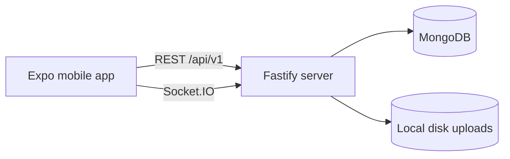

# Architecture

> Last updated: 2026-11-15 — Derived from the approved design doc `docs/designs/campus-v1.md`. `/autoplan` was not run (see decisions.md D-004); this page is the build reference.

## 0. Delivery setup
Chosen by Claude with defaults because the builder asked for an unattended overnight build (D-002). Change any line and log it.
- Testing: TDD. Unit + integration (API + real local MongoDB, Socket.IO client against a live test server). Mobile: component and hook tests (Jest + React Native Testing Library) plus a production bundle export as a compile check. No device E2E (no simulator or emulator on the build machine). Coverage target: none.
- Deployment: not yet. Backend runs on the builder's laptop; phones reach it over the same Wi-Fi.
- Docker: none. MongoDB 7 is installed and running locally.
- CI: none. CD: none. Lint, typecheck and tests run locally before every merge to `main`.

## 1. Overview
An Expo (React Native) mobile app talks to one Fastify server. The server exposes a versioned REST API (`/api/v1`) and a Socket.IO endpoint on the same port, and stores everything in MongoDB through Mongoose. Uploaded files live on the server's local disk behind a storage interface. There is no Redis and no worker: presence and rate-limit counters live in server memory, which is correct for a single process.

## 2. Component diagram


## 3. Tech stack
| Layer | Choice | Why (link decision) |
|---|---|---|
| Mobile | Expo, React Native, TypeScript, Expo Router | D-001 |
| Server state on client | TanStack Query | D-001 |
| Realtime | Socket.IO | D-001 |
| Backend | Node 20, Fastify, TypeScript, Zod | D-001 |
| Database | MongoDB 7, Mongoose | D-001 |
| Cache / queue | none | D-001 |
| Auth | Email + password (bcrypt), JWT access token, rotating refresh token stored hashed | D-005 |
| Hosting | none (local) | D-002 |
| Tests | Vitest (API), Jest + React Native Testing Library (mobile) | D-002 |

## 4. Codebase layout
```
loop/
├── apps/
│   ├── api/            Fastify server. src/config, src/lib, src/modules/<feature>, src/realtime, scripts/seed
│   └── mobile/         Expo app. app/ (routes), src/features/<feature>, src/ui (design system), src/lib
├── packages/
│   └── shared/         Zod schemas and TypeScript types used by both apps. No runtime logic besides validation
└── docs/               prd, architecture, decisions, designs
```

## 5. Modules and responsibilities
| Module (api) | Owns | Must not |
|---|---|---|
| `config` | Reading and validating env vars, limits | Be bypassed with `process.env` elsewhere |
| `modules/auth` | Signup, login, refresh, logout, sessions | Know about chat |
| `modules/university` | Schools, programs | — |
| `modules/users` | Profiles, onboarding, people search | Touch passwords |
| `modules/uploads` | Storage interface, image and attachment upload and download | Trust client filenames |
| `modules/conversations` | DMs, groups, membership, read state | Emit sockets directly (uses `realtime` gateway) |
| `modules/messages` | Send, edit, delete, react, reply, threads | — |
| `modules/clubs` | Clubs, memberships, roles | — |
| `modules/announcements` | Create, audience matching, feed | — |
| `realtime` | Socket auth, personal rooms, presence, typing, delivery helper | Contain business rules |

## 6. Layering rules
`routes` (HTTP parsing, Zod validation, auth guard) → `service` (business rules, authorization per resource) → `model` (Mongoose). Routes never call models. Socket handlers call the same services as routes. Services emit realtime events only through `realtime/gateway`.

## 7. External services
None. Everything runs on one machine.

## 8. Auth and authorization
- Signup and login return a short-lived JWT access token (15 minutes) and a refresh token (30 days). The refresh token is random, stored hashed in the `sessions` collection, and rotated on every refresh. Logout deletes the session, so the token stops working on the server.
- REST: `Authorization: Bearer <access token>`. Socket.IO: the same token in the handshake `auth` field. An expired token is rejected with `auth_expired`; the app refreshes and reconnects.
- Roles: `student`, `university_admin` (seeded). Club roles: `owner`, `admin`, `member`. Group roles: `admin`, `member`. Every service checks membership or role for the specific resource.
- Login and signup are rate limited in memory.

## 9. Error handling and logging conventions
- Success: `{ "data": ... }`, lists: `{ "data": [...], "nextCursor": string | null }`.
- Failure: `{ "error": { "code": "snake_case_code", "message": "human readable" } }` with the right HTTP status. Stack traces never leave the server.
- Services throw `AppError(code, status, message)`. One Fastify error handler maps them. Unknown errors are logged with pino and returned as `internal_error`.

## 10. Configuration
| Env var | Purpose | Required | Example |
|---|---|---|---|
| `PORT` | API port | no | `4000` |
| `MONGODB_URI` | Database connection | yes | `mongodb://127.0.0.1:27017/campus` |
| `JWT_SECRET` | Signs access tokens | yes | long random string |
| `UPLOAD_DIR` | Where files are stored | no | `./uploads` |
| `EXPO_PUBLIC_API_URL` | (mobile) Base URL of the API | yes | `http://192.168.1.10:4000` |

## 11. Data model
See the "Data model" table in `docs/designs/campus-v1.md`. Additions made during the build are logged in decisions.md.
